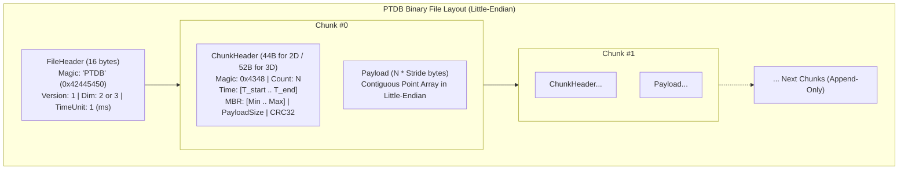

# potDB (PTDB)

**potDB** (PTDB - Point Time-Series Database) is a lightweight, append-only on-disk storage engine written in C99, designed specifically for recording, streaming, and querying high-frequency 2D and 3D spatial time-series coordinates.

$$\text{Timestamp} \longrightarrow (x, y) \quad\text{or}\quad (x, y, z)$$

---

## Key Features

- **Chunked Append-Only Architecture**: Points are accumulated in an in-memory buffer and flushed sequentially as atomic chunks. Existing data is never overwritten in place, eliminating write amplification, locking contention, and file fragmentation.
- **Strict Byte-Level Serialization**: Custom Little-Endian byte-level encoders and decoders operate without compiler packing (`#pragma pack`) hazards, preventing unaligned CPU access faults (`SIGBUS`) and ensuring cross-platform file portability.
- **Configurable Durability Modes**:
  - `PTDB_SYNC_ALWAYS` *(Default)*: Invokes `fsync()` on every chunk flush for maximum durability.
  - `PTDB_SYNC_PERIODIC`: Invokes `fsync()` once every $N$ chunk flushes (e.g., every 10 or 20 flushes) to balance throughput with crash-resilience.
  - `PTDB_SYNC_NONE`: Bypasses `fsync()` entirely, delegating disk writeback to the OS Page Cache for extreme ingestion rates (up to **5.4 Million points/sec**).
- **Two-Level Spatiotemporal Range Queries**: Filter points across both time intervals and spatial bounding boxes ($X, Y$ or $X, Y, Z$). Uses chunk headers to skip non-overlapping chunk payloads with `lseek()` before reading points.
- **Dual Flush Triggers**:
  - **Capacity Trigger**: Flushes immediately when the buffer reaches `max_points` (default: 500).
  - **Time-Window Trigger**: Flushes when $(t_{\text{current}} - t_{\text{start}}) \ge \text{max\_time\_window\_ms}$ (default: 5,000 ms), guaranteeing bounded latency on low-frequency streams.
- **Spatial Indexing & MBR**: Every chunk header stores a Minimum Bounding Rectangle (MBR) computed on the fly ($X, Y$ for 2D; $X, Y, Z$ for 3D) for efficient spatial pruning.
- **Data Integrity via IEEE 802.3 CRC-32**: Every chunk payload is checksummed upon flush and verified during sequential scan to detect hardware bit-flips and silent corruption.
- **Schema Lock**: Spatial dimension (2D or 3D) and time resolution (`ms`, `sec`, `us`, `ns`) are immutably locked in the 16-byte file header at initialization.
- **Blazing Performance**: Ingests up to **5.4 Million points/sec** in async mode and scans at **17.2 Million points/sec** with full on-the-fly CRC-32 verification.

---

## On-Disk Binary Format

Every database file consists of a single 16-byte `FileHeader` followed by zero or more sequentially appended chunks:



### 1. File Header (16 Bytes)
| Offset | Type | Field | Description |
| :--- | :--- | :--- | :--- |
| `0x00` | `uint32_t` | `magic` | Magic number `0x42445450` (`"PTDB"` in Little-Endian) |
| `0x04` | `uint16_t` | `version` | Format version (`1`) |
| `0x06` | `uint8_t` | `dim` | Coordinate dimension (`2` or `3`) |
| `0x07` | `uint8_t` | `time_unit` | Timestamp resolution (`1`: ms, `2`: s, `3`: µs, `4`: ns) |
| `0x08` | `uint64_t` | `reserved` | 8 bytes reserved for future expansion (zeroed) |

### 2. Chunk Header (44 Bytes for 2D, 52 Bytes for 3D)
| Offset | Type | Field | Description |
| :--- | :--- | :--- | :--- |
| `0x00` | `uint16_t` | `magic` | Chunk magic `0x4348` (`"CH"`) |
| `0x02` | `uint16_t` | `count` | Number of points in chunk (up to 65,535) |
| `0x04` | `int64_t` | `start_time` | Timestamp of first point in chunk |
| `0x0C` | `int64_t` | `end_time` | Timestamp of last point in chunk |
| `0x14` | `float` | `min_x`, `max_x` | Minimum and maximum X spatial bounds |
| `0x1C` | `float` | `min_y`, `max_y` | Minimum and maximum Y spatial bounds |
| `0x24` | `float` | `min_z`, `max_z` *(3D only)* | Minimum and maximum Z spatial bounds |
| `0x24 / 0x2C` | `uint32_t` | `payload_size` | Size of payload in bytes (`count * stride`) |
| `0x28 / 0x30` | `uint32_t` | `checksum` | IEEE 802.3 CRC-32 checksum of chunk payload |

---

## Build & Test Suite

### Prerequisites
- GCC or Clang (supporting C99)
- GNU Make

### Compilation Targets
```bash
# Build the main potdb CLI binary
make

# Run core functional unit tests (schema lock, flush triggers, durability modes, range queries)
make test

# Run edge-case validation suite (boundary values, limits, corrupted files)
make edge

# Run high-volume stress dump (1,000,000 points round-trip & multi-session append)
make stress

# Run empirical performance benchmarks (terminal output)
make bench

# Run benchmark and record version-controlled snapshot with comparison deltas
make bench-record MSG="my_feature" SYNC="always|periodic|none" [INTERVAL=10]

# Run all test suites in sequence
make all_tests

# Clean build artifacts
make clean
```

---

## CLI Usage

### 1. Initialize a Database
Initialize a new database with schema locking (2D or 3D, optional time unit):
```bash
# Initialize a 2D database
./potdb positions_2d.db init 2

# Initialize a 3D database with millisecond timestamps
./potdb positions_3d.db init 3 1
```

### 2. Insert Points Interactively
```bash
# Insert a 2D point: insert <timestamp> <x> <y>
./potdb positions_2d.db insert 1700000000 12.34 56.78

# Insert a 3D point: insert <timestamp> <x> <y> <z>
./potdb positions_3d.db insert 1700000000 10.5 20.3 30.8
```

### 3. Stream Points via Pipeline (stdin)
You can pipe points directly into `potdb`:
```bash
cat << 'EOF' | ./potdb positions_2d.db
1700000000 10.0 20.0
1700000010 10.5 20.5
1700000020 11.0 21.0
EOF
```

### 4. Query Points Across Time and Space
Select points matching both a time window and a spatial bounding box (with chunk-skipping acceleration):
```bash
# 2D Query: query <min_time> <max_time> <min_x> <max_x> <min_y> <max_y>
./potdb positions_2d.db query 1700000000 1700003600 10.0 50.0 -20.0 20.0

# 3D Query: query <min_time> <max_time> <min_x> <max_x> <min_y> <max_y> <min_z> <max_z>
./potdb positions_3d.db query 1700000000 1700003600 10.0 50.0 -20.0 20.0 0.0 100.0
```

### 5. Query / Dump Database Chunks
Inspect all chunks, MBR bounding boxes, CRC-32 verification status, and raw points:
```bash
./potdb positions_2d.db dump
# or
./potdb positions_2d.db select
```

---

## C API Reference

Include [`include/ptdb.h`](include/ptdb.h) in your C application:

```c
#include "ptdb.h"

// 1. Initialize database file
ptdb_init("flight_log.db", 2, PTDB_TIME_UNIT_MS);

// 2. Open for writing with custom buffer and durability config
PTDBConfig config = {
    .max_points = 5000,
    .max_time_window_ms = 10000,
    .sync_mode = PTDB_SYNC_PERIODIC,     // PTDB_SYNC_ALWAYS | PTDB_SYNC_NONE | PTDB_SYNC_PERIODIC
    .sync_interval_flushes = 10
};
PTDB *db = ptdb_open("flight_log.db", &config);

// 3. Insert coordinates (returns -2 on non-monotonic timestamp)
ptdb_insert_2d(db, 1700000000, 100.5f, 200.3f);

// 4. Force immediate flush to disk (optional)
ptdb_flush(db);

// 5. Close database (flushes remaining buffered points and executes final fsync)
ptdb_close(db);

// 6. Fast Spatiotemporal Range Query (Level 1 chunk skip + Level 2 point filter)
PTDBQueryRange2D range = {
    .min_time = 1700000000,
    .max_time = 1700003600,
    .min_x = 10.0f, .max_x = 150.0f,
    .min_y = 50.0f, .max_y = 250.0f
};

void on_point(const Point2D *pt, void *user_data) {
    // Process matching point pt->timestamp, pt->x, pt->y
}

uint64_t matches = ptdb_query_range_2d("flight_log.db", &range, on_point, NULL);

// 7. Full Sequential Reader Traversal
PTDBReader *reader = ptdb_reader_open("flight_log.db");
ChunkHeader2D ch;
void *points = NULL;
uint32_t count = 0;

while (ptdb_reader_next_chunk(reader, &ch, &points, &count) == 1) {
    for (uint32_t i = 0; i < count; i++) {
        Point2D p;
        ptdb_get_point_2d(points, i, &p);
    }
}
ptdb_reader_close(reader);
```

---

## Performance Benchmarks

Empirical performance measured on local SSD across durability modes:

### 1. Ingestion Throughput Across Durability Modes (200,000 Points)

| Chunk Buffer (`max_points`) | `PTDB_SYNC_ALWAYS` | `PTDB_SYNC_PERIODIC` (Every 10) | `PTDB_SYNC_NONE` (Page Cache) |
| :--- | :--- | :--- | :--- |
| **100** | 19,683 pts/sec | 194,779 pts/sec | **2,972,080 pts/sec** |
| **500** *(Default)* | 96,668 pts/sec | 813,048 pts/sec | **4,365,202 pts/sec** |
| **1,000** | 188,119 pts/sec | 1,385,184 pts/sec | **4,611,279 pts/sec** |
| **5,000** | 774,522 pts/sec | 3,252,558 pts/sec | **5,492,982 pts/sec** |
| **10,000** | 1,253,110 pts/sec | 4,250,237 pts/sec | **5,288,493 pts/sec** |
| **50,000** | 3,049,760 pts/sec | 4,746,433 pts/sec | **5,403,534 pts/sec** |

### 2. Sequential Read & CRC-32 Scan (500,000 Points)
- **Scan Rate**: **17,209,378 points/sec**
- **Bandwidth**: **263.32 MB/sec**
- **Integrity**: 100% verified across all chunks

### 3. In-Memory Point Accessor Latency
- `ptdb_get_point_2d`: **10.67 ns/point** (~93M points/sec)
- `ptdb_get_point_3d`: **15.33 ns/point** (~65M points/sec)

---

## Project Structure

```
├── include/
│   ├── chunk.h            # Header layouts, constants, Point2D/3D, PTDBConfig & sync modes
│   ├── file.h             # FileHeader definition and time unit macros
│   ├── serialize.h        # Little-Endian encoders/decoders and header serializers
│   ├── crc32.h            # IEEE 802.3 CRC-32 checksum declarations
│   ├── writer.h           # Write engine declarations (init, open, insert, flush, close)
│   ├── reader.h           # Read engine declarations (reader, range query cover functions)
│   └── ptdb.h             # Master umbrella public API header
├── src/
│   ├── main.c             # CLI application entry point (init, insert, query, dump)
│   ├── crc32.c            # Precomputed table and checksum logic
│   ├── writer.c           # Ingestion buffer, dual flush triggers, MBR calculation
│   └── reader.c           # Sequential chunk reader and spatiotemporal query engine
├── examples/
│   └── quickstart.c       # Self-contained embedded DB example
├── web/
│   ├── index.html         # In-browser GPS walk tracker UI
│   ├── style.css          # Responsive dark-mode map interface styling
│   ├── app.js             # Wasm engine lifecycle, GPS hooks, and Leaflet polyline renderer
│   ├── potdb.js           # Emscripten glue code & virtual filesystem
│   └── potdb.wasm         # Compiled WebAssembly C engine
├── bench/
│   ├── bench_ptdb.c       # Empirical throughput and latency benchmark binary
│   ├── record.sh          # POSIX shell automated comparison script
│   └── history/           # Version-controlled JSON benchmark snapshots
├── tests/
│   ├── test_unit.c        # Schema, flush triggers, durability modes, range queries
│   ├── test_edge_cases.c  # Coordinate bounds, limits, and malformed files
│   └── test_stress.c      # 1M points round-trip and multi-session appends
├── docs/
│   ├── integration_guide.md# Developer handbook for embedding potDB in any application
│   ├── embedding_approaches.md # In-depth guide to FFI, Native Addons, and Sidecar architectures
│   ├── wasm_compilation_guide.md # WebAssembly compilation & in-browser embedding guide
│   ├── auto_flush.md      # OS Page Cache, writeback mechanics & durability modes
│   ├── byte_reading.md    # Serialization and unaligned memory access guide
│   ├── benchmark_report.md# Architecture & performance analysis report
│   └── benchmark_history.md# Cumulative benchmark comparison log
├── Makefile               # Modular compilation targets (potdb, lib, test, bench)
└── README.md              # Project documentation
```

---

## Detailed Documentation

- [**`docs/integration_guide.md`**](docs/integration_guide.md): Developer handbook for embedding `potDB` in any application (static linking, CMake, tuning recipes).
- [**`docs/embedding_approaches.md`**](docs/embedding_approaches.md): In-depth breakdown of the three multi-stack architectures (In-Process FFI, Native Addons, and Micro-Daemon sidecars).
- [**`docs/wasm_compilation_guide.md`**](docs/wasm_compilation_guide.md): WebAssembly (Wasm) compilation guide using Emscripten for 100% client-side browser apps.
- [`docs/auto_flush.md`](docs/auto_flush.md): In-depth guide on Linux Page Cache, kernel `b_dirty` queues, and the three durability modes.
- [`docs/benchmark_report.md`](docs/benchmark_report.md): In-depth architecture diagrams, memory access analysis, and complete benchmark metrics.
- [`docs/benchmark_history.md`](docs/benchmark_history.md): Living delta log tracking benchmark performance improvements across features.
- [`docs/byte_reading.md`](docs/byte_reading.md): Detailed explanation of `#pragma pack(1)` alignment hazards, CPU faults, and byte-level serialization.


