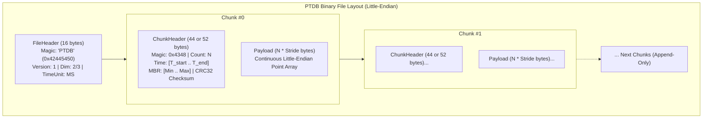
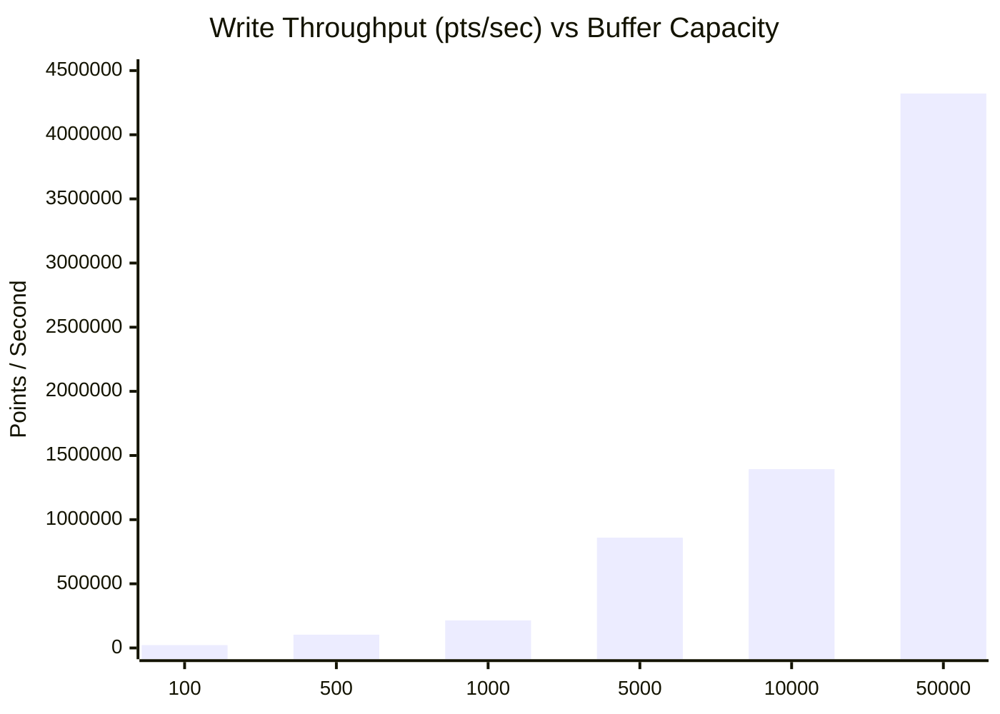

# PTDB Engine: Architecture Summary & Benchmark Performance Report

This report provides an architectural overview of the **potdb (PTDB)** time-series point storage engine and summarizes recent empirical benchmark results.

---

## 1. Engine Architecture Summary

`potdb` (PTDB - Point Time-Series Database) is a specialized, lightweight, append-only on-disk storage engine engineered for high-frequency 2D and 3D spatial time-series telemetry.

### Core Architectural Pillars

1. **Chunked Append-Only Model**:
   - Points are buffered in user-space RAM and flushed sequentially to disk as atomic chunks.
   - Existing disk blocks are never modified or rewritten in place, eliminating write amplification, locking contention, and fragmentation.
2. **Schema Locking at File Header**:
   - The 16-byte `FileHeader` fixes the spatial dimension (2D or 3D) and time unit (`ms`, `sec`, `us`, `ns`) at creation. Heterogeneous inserts are rejected upfront.
3. **Dual-Trigger Buffer Flushing**:
   - **Capacity Trigger**: Flushes immediately when in-memory buffer reaches `max_points` (default: 500).
   - **Time-Window Trigger**: Flushes when $(t_{\text{current}} - t_{\text{start}}) \ge \text{max\_time\_window\_ms}$ (default: 5,000 ms), bounding maximum staleness.
4. **Explicit Byte-Level Serialization (Alignment & Endian Safe)**:
   - Uses zero-overhead byte-level serializers (`put_le16`, `put_le32`, `put_le64`, `put_le_float`).
   - Guarantees zero unaligned memory access penalties (`SIGBUS`), immunity to struct padding/packing variances, and consistent byte order across different CPU architectures.
5. **Spatial Indexing & Integrity Metadata per Chunk**:
   - **MBR (Minimum Bounding Rectangle)**: Maintains tight axis-aligned bounding boxes ($X, Y$ for 2D; $X, Y, Z$ for 3D) computed on the fly during buffering.
   - **IEEE 802.3 CRC-32**: Checksum precomputed over raw chunk payload and stored in the header, enabling corrupted chunk detection on scan.

---

## 2. Ingestion Benchmark vs Buffer Size

> [!NOTE]
> Every chunk flush invokes an `fsync(db->fd)` system call to guarantee data persistence to physical storage. The table below illustrates the relationship between chunk buffer capacity (`max_points`) and write throughput over **200,000 2D points**.

| Buffer Size (`max_points`) | Elapsed Time | Write Throughput | Storage Bandwidth | Chunk Flushes (`fsync`) | Avg Flush Interval |
| :--- | :--- | :--- | :--- | :--- | :--- |
| **100** | 8.9535 s | 22,338 pts/sec | 0.35 MB/s | 2,000 | 4.47 ms |
| **500** *(Default)* | 1.9279 s | 103,740 pts/sec | 1.59 MB/s | 400 | 4.81 ms |
| **1,000** | 0.9314 s | 214,737 pts/sec | 3.29 MB/s | 200 | 4.65 ms |
| **5,000** | 0.2326 s | 859,667 pts/sec | 13.12 MB/s | 40 | 5.81 ms |
| **10,000** | 0.1435 s | 1,393,281 pts/sec | 21.27 MB/s | 20 | 7.17 ms |
| **50,000** | 0.0463 s | **4,320,862 pts/sec** | **65.94 MB/s** | 4 | 11.57 ms |

### Analysis
- At small buffer sizes (`100`), the throughput is strictly bound by disk IOPS (~223 `fsync` calls/sec).
- Increasing the buffer to `10,000` points achieves **1.39 Million points/sec** with minimal memory footprint (~160 KB RAM).
- Increasing to `50,000` points pushes throughput to **4.32 Million points/sec** (~66 MB/s).

---

## 3. Read & Scan Throughput Benchmark

Sequential chunk scanning was evaluated using `PTDBReader` across **500,000 points** in 500 chunks (7.65 MB file).

| Metric | Result |
| :--- | :--- |
| **Total Points Scanned & Verified** | 500,000 points |
| **Total Chunks Verified** | 500 chunks |
| **Elapsed Scan Time** | **0.0291 seconds** |
| **Read Throughput** | **17,209,378 points/second** |
| **Effective Read Bandwidth** | **263.32 MB/second** |
| **CRC-32 Integrity Verification** | 100% verified (0 corruptions) |

The sequential scan performance allows the engine to scan over **17 million points per second** while simultaneously verifying IEEE 802.3 CRC-32 checksums for every chunk.

---

## 4. In-Memory Point Accessor Latency

The engine provides byte-level accessors (`ptdb_get_point_2d`, `ptdb_get_point_3d`) to read points from mapped/read buffers without unaligned memory access penalties.

| Accessor Function | Latency per Point | Deserialization Throughput |
| :--- | :--- | :--- |
| `ptdb_get_point_2d` | **10.97 ns** | **91,166,649 points/second** |
| `ptdb_get_point_3d` | **13.31 ns** | **75,154,617 points/second** |

Deserialization overhead is negligible (~11–13 nanoseconds), making analytical processing fast and CPU cache-friendly.

---

## 5. High-Volume Stress & Recovery Validation

| Stress Scenario | Ingestion Speed | File Size | Read Verification Speed | Integrity Status |
| :--- | :--- | :--- | :--- | :--- |
| **1,000,000 2D Points** (2,000 Chunks) | 106,165 pts/s (9.42 s) | 15.34 MB | **14,679,103 pts/s** (0.068 s) | **100% Pass** |
| **1,000,000 3D Points** (1,000 Chunks) | 202,946 pts/s (4.93 s) | 22.94 MB | **10,360,757 pts/s** (0.097 s) | **100% Pass** |
| **Multi-Session Continuity** (200 Sessions) | 50,000 points appended | ~804 KB | Full chunk traversal | **100% Pass** |

---

## 6. Recommendations & Tuning Guidelines

1. **Recommended Buffer Size**:
   - For real-time applications requiring low persistence latency: `max_points = 1,000` to `5,000` balances high throughput (>850K pts/s) with small buffer memory (~80 KB).
   - For bulk import or batch logging: `max_points = 10,000` to `50,000` provides maximum write throughput (>4M pts/s).
2. **Buffer Limits**:
   - Since `count` in `ChunkHeader2D`/`3D` is a `uint16_t`, `max_points` is strictly clamped to `65,535` by the engine to prevent integer wrap-around.
3. **Durability Modes**:
   - Current engine calls `fsync()` on each flush. If asynchronous flushing (operating system page-cache writeback) is preferred for extreme ingestion workloads, a config flag `sync_on_flush` can be considered in future iterations.
