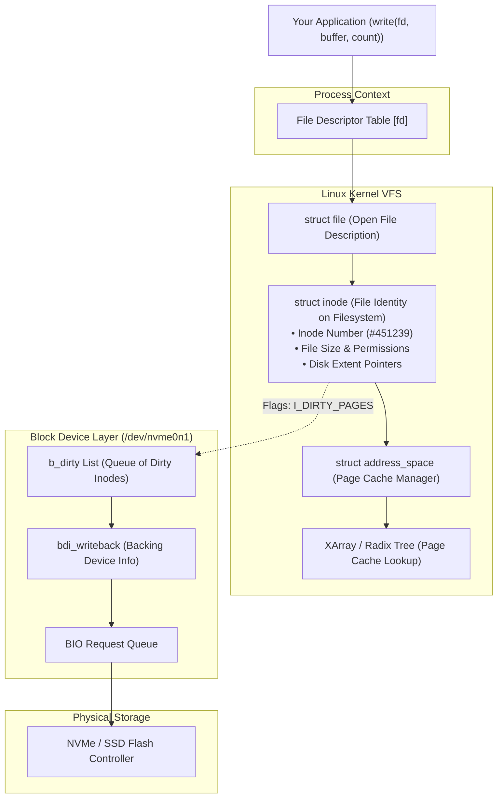
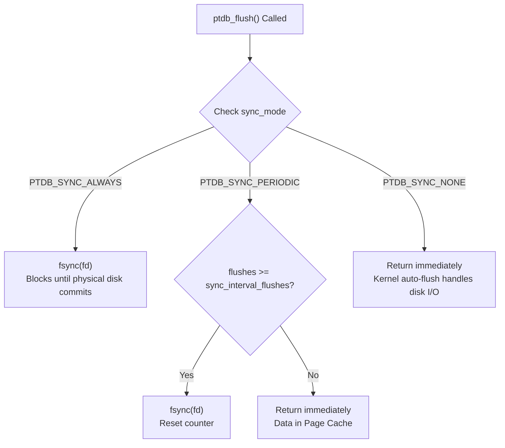

# Operating System Auto-Flush, Page Cache & Durability Modes

This document explains how the operating system kernel manages data persistence in `potDB` (PTDB), how the kernel tracks dirty files, and how each of the three configurable durability modes (`PTDB_SYNC_ALWAYS`, `PTDB_SYNC_PERIODIC`, and `PTDB_SYNC_NONE`) operates.

---

## 1. User-Space Flush vs Kernel Disk Flush

When `ptdb_flush()` executes:

1. **User-Space Flush (`write()` system call)**:
   The database flushes its internal RAM buffer into the kernel via `write(db->fd, ...)`. The data leaves the database process and resides in the operating system's **Page Cache**. At this point, the `write()` system call returns (~1–2 microseconds).
2. **Physical Disk Flush (`fsync()` or kernel writeback)**:
   Transferring dirty pages from the kernel Page Cache to physical flash memory (SSD / NVMe) or magnetic platters (HDD). How and when this occurs is controlled by the configured durability mode.

---

## 2. Kernel Data Structures: From `fd` to Physical Blocks

The Linux kernel connects an application file descriptor (`fd`) to physical disk blocks through a hierarchy of in-memory data structures:



---

## 3. How the Kernel Knows Which File to Flush

The kernel tracks dirty files without scanning all system memory using three mechanisms:

### A. The `address_space` and `inode` Relationship
Every open file descriptor points to an in-memory `struct file`, which holds a reference to a unique `struct inode`:
* An **`inode`** represents the file's metadata and disk presence.
* An `inode` owns a `struct address_space` representing its cached pages in RAM.
* Modified 4 KB memory pages within the `address_space` have their hardware **`PG_dirty`** bit set.

### B. The Dirty Inode Queue (`b_dirty`)
Scanning gigabytes of RAM to search for dirty pages would cause severe CPU overhead. Instead, Linux uses an event-driven queue:
1. When `write()` marks a page dirty, the kernel tags the parent `inode` with the **`I_DIRTY_PAGES`** flag.
2. The kernel inserts that `inode` into a doubly-linked list on the backing storage device called **`b_dirty`** (part of `bdi_writeback`).
3. Clean files are never added to `b_dirty`.

### C. Fast Page Lookup via XArray / Radix Tree
When writeback triggers for a specific `inode`:
* The kernel accesses the inode's page cache tree (an XArray).
* Nodes in the tree maintain a **`PAGECACHE_TAG_DIRTY`** bitmap.
* The kernel traverses only the branches leading directly to dirty pages in $O(\log N)$ time, skipping clean memory.

---

## 4. The Three PTDB Durability Modes

`potDB` exposes three durability modes via [`PTDBConfig`](../include/chunk.h):

```c
#define PTDB_SYNC_ALWAYS   0
#define PTDB_SYNC_NONE     1
#define PTDB_SYNC_PERIODIC 2
```



---

### Mode 1: `PTDB_SYNC_ALWAYS` (Default)

* **Behavior**: Every time `ptdb_flush()` completes writing a chunk header and payload, it immediately issues a blocking `fsync(db->fd)` system call.
* **Mechanism**:
  1. `write(fd, header)` + `write(fd, payload)`
  2. `fsync(fd)` tells the OS kernel to flush all dirty pages of this specific inode right now, and issues a hardware cache flush command (`SYNCHRONIZE CACHE` / NVMe Flush) to the SSD controller.
  3. The function returns only when the physical flash memory has committed the bytes.
* **Throughput**: ~22,000 pts/sec (at 100 pts/chunk) up to ~4.3M pts/sec (at 50,000 pts/chunk).
* **Guarantees**: **Maximum Durability**. Zero data loss even on immediate physical power loss.
* **Recommended For**: Mission-critical sensor tracking, transactional event streams, flight telemetry.

---

### Mode 2: `PTDB_SYNC_NONE`

* **Behavior**: `ptdb_flush()` writes the chunk into the OS Page Cache via `write()` and returns immediately without calling `fsync()`.
* **Mechanism**:
  1. `write(fd, header)` + `write(fd, payload)`
  2. The kernel tags the inode as `I_DIRTY_PAGES` and places it on `b_dirty`.
  3. The database thread never waits for disk hardware; background kernel threads (`wb_workfn`) flush dirty blocks asynchronously according to kernel sysctl knobs:
     - `vm.dirty_writeback_centisecs` (default: every 500 centisecs = 5 seconds)
     - `vm.dirty_expire_centisecs` (default: 3000 centisecs = 30 seconds)
     - `vm.dirty_background_ratio` (default: 10% of system RAM)
* **Throughput**: Extreme write performance across all chunk sizes (~100x faster for small chunks).
* **Guarantees**:
  - **App Crash (`kill -9`, SIGSEGV)**: **Zero Data Loss**. Kernel page cache remains alive and writes to disk.
  - **Clean Close (`ptdb_close`)**: **Zero Data Loss**.
  - **Sudden Host Power Cut**: Data flushed within the last writeback window (0–5 seconds) may not have reached the physical drive.
* **Recommended For**: High-frequency telemetry streams, volatile metric logging, benchmarks.

---

### Mode 3: `PTDB_SYNC_PERIODIC`

* **Behavior**: Combines the high speed of `PTDB_SYNC_NONE` with a bounded durability window. Chunks are written to the kernel immediately, but `fsync()` is only called once every $N$ chunk flushes (configured by `sync_interval_flushes`, default: 10).
* **Mechanism**:
  1. Increments `db->flushes_since_sync` on every chunk flush.
  2. If `db->flushes_since_sync >= db->config.sync_interval_flushes`, issues `fsync(db->fd)` and resets the counter to 0.
  3. On `ptdb_close(db)`, any un-synced flushes trigger a final `fsync()`, ensuring clean shutdown durability.
* **Throughput**: Amortizes `fsync` overhead by a factor of $N$ while maintaining a strictly bounded data loss window (at most $N - 1$ chunks lost on sudden host power loss).
* **Recommended For**: Edge IoT gateways, balanced real-time telemetry where sub-second durability is acceptable.

---

## 5. Durability & Failure Matrix Summary

| Failure Scenario | `PTDB_SYNC_ALWAYS` | `PTDB_SYNC_PERIODIC` | `PTDB_SYNC_NONE` |
| :--- | :--- | :--- | :--- |
| **Application Crash (`kill -9`, SIGSEGV)** | Zero data loss | Zero data loss | Zero data loss |
| **Clean Database Shutdown (`ptdb_close`)** | Zero data loss | Zero data loss (final `fsync`) | Zero data loss |
| **Sudden Host Power Loss / Hard Reset** | **Zero data loss** (committed to disk) | At most $N - 1$ chunks lost | Last 0–5 seconds in kernel Page Cache lost |
| **Relative Flush Latency** | High (~1–5 ms / flush) | Low (~1–2 µs, periodic 1–5 ms) | Ultra Low (~1–2 µs / flush) |
