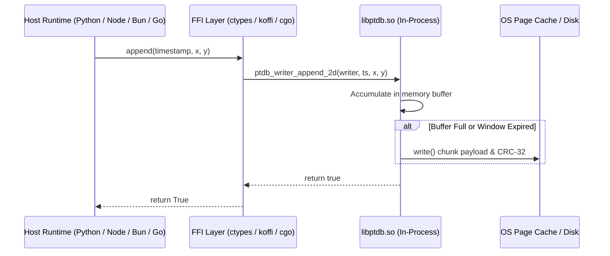
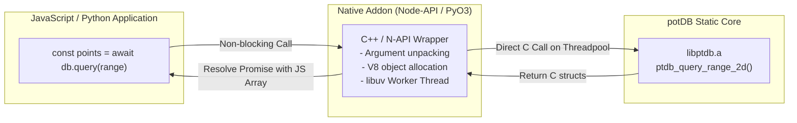
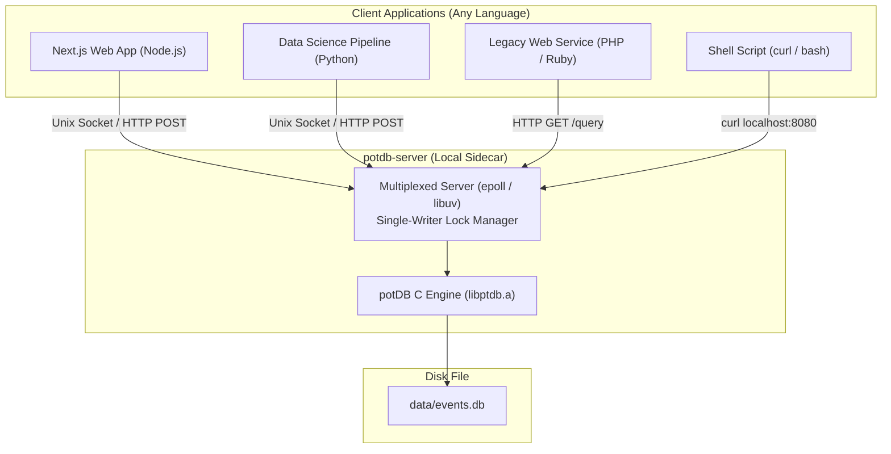

# potDB Multi-Stack Integration Architectures

This document details the architectural patterns for integrating **potDB** (PTDB) into external applications across any programming language or framework (C, C++, Python, Next.js, Node.js, Go, Rust, Ruby, PHP, etc.).

---

## Architecture Overview

```
                                  ┌───────────────────────────────────────────────┐
                                  │             potDB C Storage Engine            │
                                  │         (Append-Only Log: include/ptdb.h)     │
                                  └──────────────────────┬────────────────────────┘
                                                         │
             ┌───────────────────────────────────────────┼───────────────────────────────────────────┐
             │                                           │                                           │
             ▼                                           ▼                                           ▼
  ┌─────────────────────┐                     ┌─────────────────────┐                     ┌─────────────────────┐
  │   The Native Path   │                     │     Approach 1      │                     │     Approach 2      │
  │     (C and C++)     │                     │   In-Process FFI    │                     │    Native Addons    │
  │     libptdb.a       │                     │    libptdb.so       │                     │   (Node-API/PyO3)   │
  └──────────┬──────────┘                     └──────────┬──────────┘                     └──────────┬──────────┘
             │                                           │                                           │
      Direct Machine Call                         C Dynamic ABI                               Language Runtime
    (Inlined / Linked Code)                    (ctypes, koffi, cgo)                          (npm / pip package)
             │                                           │                                           │
             ▼                                           ▼                                           ▼
      Peak performance,                           Direct memory calls,                        Idiomatic objects,
     zero translation layer                      zero server overhead                        async threadpool
                                                         │
                                                         │ Or for multi-process / zero-FFI
                                                         ▼
                                              ┌─────────────────────┐
                                              │     Approach 3      │
                                              │   Embedded Daemon   │
                                              │  (Unix Sock / HTTP) │
                                              └──────────┬──────────┘
                                                         │
                                                  Loopback Sockets
                                                (fetch, curl, IPC)
                                                         │
                                                         ▼
                                                Multi-process safe,
                                                universal compatibility
```

---

## The Native Path: C and C++ Applications

When your application is written in **C** or **C++**, you do not need any translation layers, wrappers, or IPC sockets.

### Recommended Pattern: Direct Static Linking (`libptdb.a`)
* **How it works**: Compile `potDB` as a static library (`make lib` produces `build/libptdb.a`) and link it directly at compile time into your binary.
* **Why it's optimal**:
  1. **Zero Overhead**: Direct native machine call instructions (`call`) without wrapper indirection.
  2. **Compile-Time Type Safety**: The compiler validates all struct definitions, arguments, and return codes against `include/ptdb.h`.
  3. **Single Self-Contained Binary**: The database engine is embedded inside your executable; there are no external `.so` dynamic library paths (`LD_LIBRARY_PATH`) or runtime dependencies.
  4. **Native C++ Compatibility**: All headers feature `extern "C"` guards, enabling immediate usage in modern C++ (C++11 through C++23).

```
┌────────────────────────────────────────────────────────┐
│                   Your C / C++ Binary                  │
│                                                        │
│   #include "ptdb.h"                                    │
│   ptdb_insert_2d(db, ts, x, y);                        │
│             │                                          │
│             ▼ (Direct Inlined / Machine Call)          │
│   Embedded libptdb.a (writer.o, reader.o, crc32.o)     │
└──────────────────────────┬─────────────────────────────┘
                           │ POSIX write()
                           ▼
                    storage_file.db
```

For the step-by-step 60-second quickstart, CMake snippets, tuning recipes, and concurrency rules for C/C++, refer to:
👉 [**Developer Integration & Embedding Guide (`docs/integration_guide.md`)**](integration_guide.md).

---

## Approach 1: In-Process C ABI / Foreign Function Interface (FFI)

### How It Works
The C source code is compiled into a dynamic shared library (`libptdb.so` on Linux, `libptdb.dylib` on macOS, `libptdb.dll` on Windows). The target host language runtime uses dynamic linking (`dlopen` and `dlsym`) via its built-in or third-party FFI mechanism to map C data structures and call C functions directly in memory.

No translation server, network socket, or process boundary is involved. The host process calls `ptdb_writer_append_2d` or `ptdb_query_range_2d` as if it were a native subroutine.



### Implementation Patterns

#### A. Python (`ctypes` — Standard Library, Zero Extra Packages)
```python
import ctypes
from ctypes import c_bool, c_char_p, c_uint8, c_uint32, c_uint64, c_double, c_int, Structure

lib = ctypes.CDLL("./build/libptdb.so")

class PTDBConfig(Structure):
    _fields_ = [
        ("max_points_per_chunk", c_uint32),
        ("max_time_window_ms", c_uint64),
        ("durability_mode", c_int)
    ]

lib.ptdb_init_storage.argtypes = [c_char_p, c_uint8, c_uint8]
lib.ptdb_init_storage.restype = c_bool

lib.ptdb_writer_open.argtypes = [c_char_p, PTDBConfig]
lib.ptdb_writer_open.restype = ctypes.c_void_p

lib.ptdb_writer_append_2d.argtypes = [ctypes.c_void_p, c_uint64, c_double, c_double]
lib.ptdb_writer_append_2d.restype = c_bool

lib.ptdb_writer_close.argtypes = [ctypes.c_void_p]

# Initialize and append
lib.ptdb_init_storage(b"telemetry.db", 2, 0)
cfg = PTDBConfig(max_points_per_chunk=500, max_time_window_ms=1000, durability_mode=1)
writer = lib.ptdb_writer_open(b"telemetry.db", cfg)
lib.ptdb_writer_append_2d(writer, 1700000000, 37.7749, -122.4194)
lib.ptdb_writer_close(writer)
```

#### B. Node.js & Next.js (`koffi` — High-Performance FFI)
```typescript
import koffi from 'koffi';

const lib = koffi.load('./build/libptdb.so');
const PTDBConfig = koffi.struct('PTDBConfig', {
  max_points_per_chunk: 'uint32_t',
  max_time_window_ms: 'uint64_t',
  durability_mode: 'int',
});
const PTDBWriter = koffi.opaque('PTDBWriter');

const ptdb_writer_open = lib.func('PTDBWriter* ptdb_writer_open(const char *path, PTDBConfig config)');
const ptdb_writer_append_2d = lib.func('bool ptdb_writer_append_2d(PTDBWriter *w, uint64_t ts, double x, double y)');
const ptdb_writer_close = lib.func('void ptdb_writer_close(PTDBWriter *w)');
```

### Strengths & Trade-offs
- **Strengths**:
  - **Peak Performance**: Sub-microsecond call overhead; zero data serialization or IPC overhead.
  - **Zero / Minimal Dependencies**: Python needs no external packages (`pip install` not required). Bun uses built-in `bun:ffi`.
  - **True Embedded Engine**: Operates identically to SQLite or LMDB inside the host application.
- **Trade-offs**:
  - **Memory Safety Hazard**: Incorrect C types or pointer handling in host code can cause a segmentation fault that crashes the host process.
  - **Single-Writer Constraint**: If the host application runs in multiple worker processes (e.g., Gunicorn with multiple workers or Node.js cluster mode), only one process can hold the writer lock.

---

## Approach 2: First-Party Language Bindings / Native Addons

### How It Works
Rather than using generic FFI, a specialized native bridge is compiled against the host runtime's internal C/C++ API (such as **Node-API / N-API** for Node.js or **Python C Extensions / PyO3** for Python). 

The native bridge handles type conversions (e.g., converting a C array directly into a V8 JavaScript Array or Python List), memory lifecycle management (garbage collection hooks when objects are dereferenced), and async offloading (running queries on the libuv background threadpool to avoid blocking the JavaScript event loop).



### Implementation Patterns

#### Node-API Example (`node-addon-api`)
```cpp
#include <napi.h>
extern "C" {
  #include "writer.h"
  #include "reader.h"
}

class PTDBBinding : public Napi::ObjectWrap<PTDBBinding> {
public:
  static Napi::Object Init(Napi::Env env, Napi::Object exports);
  PTDBBinding(const Napi::CallbackInfo& info);

private:
  PTDBWriter* writer_;
  Napi::Value Append2D(const Napi::CallbackInfo& info);
};

Napi::Value PTDBBinding::Append2D(const Napi::CallbackInfo& info) {
  Napi::Env env = info.Env();
  uint64_t ts = info[0].As<Napi::Number>().Int64Value();
  double x = info[1].As<Napi::Number>().DoubleValue();
  double y = info[2].As<Napi::Number>().DoubleValue();

  bool ok = ptdb_writer_append_2d(writer_, ts, x, y);
  return Napi::Boolean::New(env, ok);
}
```

The consumer installs and uses it just like any native npm module:
```typescript
import { PTDB } from 'potdb';

const db = new PTDB('telemetry.db');
await db.append2D(Date.now(), 37.77, -122.41);
const points = await db.queryRange({ minX: 10, maxX: 20 });
```

### Strengths & Trade-offs
- **Strengths**:
  - **Idiomatic Developer Experience**: Returns native language objects, classes, Promises, and iterators.
  - **Thread Safety & Async Execution**: Heavy queries execute on background worker threads without freezing the UI or HTTP server event loop.
  - **Automatic Memory Cleanup**: Finalizers / destructors ensure file descriptors and buffers close automatically when garbage collected.
  - **Standard Distribution**: Can be published to package registries (`npm install potdb` or `pip install potdb`) with prebuilt binaries via `prebuildify` or `cibuildwheel`.
- **Trade-offs**:
  - **Compilation Complexity**: Requires C/C++ compiler toolchains during install or complex cross-compilation CI pipelines to publish precompiled binaries for every OS and CPU architecture (x86_64, aarch64, Windows, macOS, Linux).

---

## Approach 3: Embedded Micro-Daemon / Sidecar Process (IPC / HTTP)

### How It Works
Instead of loading the database engine into the application's process memory, a lightweight standalone executable (`potdb-server` or `potdb daemon`) runs as a local sidecar process on the same machine.

The user's web or backend application connects to the daemon using standard loopback mechanisms:
- **Unix Domain Sockets** (`/var/run/potdb.sock`): Extremely fast local IPC with latencies under 10 microseconds.
- **Localhost HTTP / REST / WebSocket** (`http://127.0.0.1:8080`): Universal compatibility with any programming language.



### Implementation Patterns

#### A. Ingestion over HTTP / JSON
```bash
# Ingest single coordinate
curl -X POST http://127.0.0.1:8080/api/v1/points \
  -H "Content-Type: application/json" \
  -d '{"ts": 1700000000, "x": 37.7749, "y": -122.4194}'
```

#### B. Next.js / React Client Fetch
```typescript
// Any language or framework can query without native C dependencies
export async function fetchPoints(minX: number, maxX: number) {
  const res = await fetch(`http://127.0.0.1:8080/api/v1/query?min_x=${minX}&max_x=${maxX}`);
  const data = await res.json();
  return data.points;
}
```

### Strengths & Trade-offs
- **Strengths**:
  - **100% Language Agnostic**: Works with PHP, Ruby, Java, C#, Bash, Next.js Edge Runtime, Python, and Go without requiring any C toolchains or FFI libraries.
  - **Solves Multi-Process Concurrency**: Multiple Next.js worker threads, Gunicorn workers, or background jobs can simultaneously send writes to the daemon. The daemon arbitrates writes sequentially through its single writer handle.
  - **Process Isolation / Crash Fault Tolerance**: A bug or segmentation fault in the storage engine cannot crash the client web server, and vice versa.
- **Trade-offs**:
  - **Serialization & IPC Overhead**: JSON encoding/decoding and socket hops add small latency (~10–50 µs on Unix sockets, ~100–300 µs on HTTP) compared to direct in-process FFI (<1 µs).
  - **Operational Requirement**: A separate background process must be supervised (via systemd, Docker, or child process spawning).

---

## Comprehensive Comparison Matrix

| Feature / Metric | The Native Path (C/C++) | Approach 1: In-Process FFI (`.so`) | Approach 2: Native Addon (N-API / PyO3) | Approach 3: Embedded Daemon (Sidecar) |
| :--- | :--- | :--- | :--- | :--- |
| **Ingestion Latency** | **< 0.1 µs** (Inlined / Branch) | **< 1 µs** (Direct CPU branch) | **< 1 µs** (Direct CPU branch) | **10–50 µs** (Unix Socket) / **100 µs** (HTTP) |
| **Max Throughput** | **5.4M points/sec** (Raw engine) | **5.4M points/sec** | **4–5M points/sec** | **500K–1M points/sec** (Socket bound) |
| **Client Dependencies** | `libptdb.a` static archive | `libptdb.so` + FFI helper | Compiled native package (`npm`/`pip`)| Standard HTTP client (`fetch`, `curl`) |
| **Host Toolchain Required?** | Standard C/C++ compiler | None (prebuilt `.so` suffices) | Yes (or precompiled binary wheels)   | None (zero C/C++ toolchain needed) |
| **Crash Blast Radius** | Process crashes on fault | Process crashes on fault | Process crashes on fault | **Isolated** (only daemon restarts) |
| **Multi-Worker Concurrency**| Single process (or mutex) | Single process only | Single process only | **Safe** (daemon arbitrates writes) |
| **Language Portability** | C and C++ only | Any language with C ABI | Specific to language target | **Universal** (all runtimes) |
| **Maintenance Burden** | Minimal (native C API) | Minimal (maintain C ABI) | High (per-runtime bindings) | Medium (server binary & protocol) |

---

## Selection Decision Guide

```
Is your application written in C or C++?
 ├── YES ──► The Native Path: Link build/libptdb.a directly (docs/integration_guide.md).
 │           No FFI, no wrappers, zero overhead, single binary.
 └── NO
      │
      Does your application run across multiple worker processes (e.g. Gunicorn, Node cluster, multiple pods)?
       ├── YES ──► Approach 3 (Micro-Daemon / Sidecar): Arbitrates single-writer file lock safely.
       └── NO
            │
            Does your target language have simple native FFI (Python ctypes, Node koffi, Bun ffi)?
             ├── YES ──► Approach 1 (In-Process FFI): Zero build setup, maximum speed, standard C library.
             └── NO  ──► Approach 2 (Native Addon): Package as an idiomatic npm/pip module with async threads.
```
