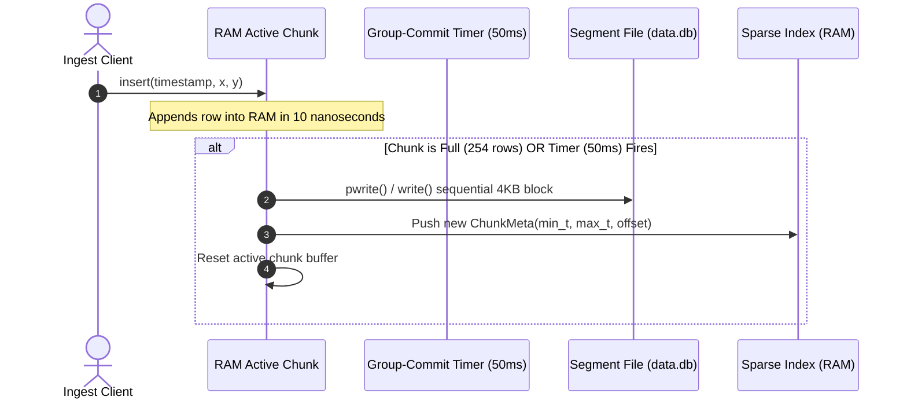

# potDB Architectural Redesign Blueprint

## 1. Executive Summary & Vision

**potDB** was originally prototyped as a general-purpose, page-based embedded key-value database featuring an on-disk B+ Tree, Write-Ahead Logging (WAL), and interactive ACID transactions (`begin`, `commit`, `rollback`).

However, the real-world domain requirement is strictly:

$$\text{Time} \longrightarrow (x, y) \text{ Coordinates}$$

High-frequency, millisecond-level telemetry ingestion (e.g., robotics, drones, IoT trackers) has fundamentally different storage characteristics than relational or document workloads:
1. **Append-Only:** Timestamps are monotonically increasing ($t_1 < t_2 < \dots < t_n$). Out-of-order writes and historical updates are nonexistent.
2. **Immutable History:** Past coordinates never change.
3. **Bulk Retention over Granular Deletions:** Data is pruned by dropping time windows (e.g., delete chunks older than 7 days), never by deleting individual timestamps.
4. **Range-Centric Reads:** Queries scan chronological trajectories (`select from T_start to T_end`), rarely individual isolated points.

This blueprint outlines the complete redesign of **potDB** into a **specialized, zero-copy, append-only time-series storage engine with segmented chunks and a sparse in-memory index**.

---
### A. What to Remove (Dead Weight)
- **B+ Tree Splitting & Underflow Machinery (`src/btree.c`, `include/btree.h`, `include/node.h`):**
  - Delete `leaf_node_split_and_insert()`, `internal_node_split_and_insert()`, `create_new_root()`.
  - Delete underflow borrowing, sibling merging, and child redistribution (`leaf_node_handle_underflow()`, `internal_node_handle_underflow()`).
  - *Rationale:* With monotonic keys, inserts always hit the right edge. Standard 50/50 splits waste 50% of page capacity and introduce unnecessary random I/O.
- **Row-Level Deletions (`leaf_node_delete()`):**
  - Completely eliminate single-key deletion.
  - *Rationale:* Historical sensor positions are immutable.
- **Interactive Multi-Statement Transactions (`src/transaction.c`, `include/transaction.h`):**
  - Remove `begin`, `commit`, and `rollback` REPL commands.
  - Remove transaction states (`PARTIALLY_COMMITTED`, `ABORTED`, etc.) and page rollback restoration routines.
  - *Rationale:* Telemetry streams are continuous feeds. Clients do not execute interactive transactions.
- **Dual-File Write-Ahead Log (`src/wal.c`, `include/wal.h`):**
  - Remove the secondary `.wal` log file.
  - *Rationale:* In an append-only architecture, the **data segment IS the log**. Running a separate WAL duplicates write amplification by 2x.

### B. What to Update
- **`Pager` (`src/pager.c`):**
  - Convert from a random 4 KB slot pager into a **Sequential Chunk Manager**.
  - Pages are written strictly in sequential append order. No random in-place overwrites.
- **`Row` & `Position` Representation (`include/row.h`):**
  - Pack rows densely: `timestamp` (8 bytes, int64) + `x` (4 bytes, int32) + `y` (4 bytes, int32) = **16 bytes fixed size**.
- **Query Engine & REPL (`src/repl.c`, `src/statement.c`):**
  - Replace full-table `select` with range queries: `select <t_start> <t_end>` and `select latest [N]`.
  - Add streaming / batch insert: `insert <x> <y>` (auto-stamped) or `batch_insert <count> [binary payload]`.

### C. What to Add
- **In-Memory Sparse Index:**
  - Fast, compact lookup table tracking `(min_timestamp, max_timestamp, chunk_offset)` for each 4 KB page.
- **Micro-Batcher / Group-Commit Flush Loop:**
  - In-RAM page buffer that flushes to disk when full (255 rows) or when a duration threshold (e.g. 50 ms) expires.
- **Partitioned Retention / Ring-Buffer:**
  - Fixed-file circular storage or timestamp-based segment pruning.

---

## 3. Storage Architecture: Segmented Chunks & Sparse Index

Instead of a deep tree, data is structured as flat, contiguous **4096-byte (4 KB) Chunks**.

```
[ Ingest Stream ] ──> [ Active RAM Chunk (4 KB) ]
                              │
                      (Full / Timer Flush)
                              │
                              ▼
                 =============================
                  Segment File (e.g. data.db)
                 =============================
                 +---------------------------+
                 |  Chunk 0 (4 KB, 255 rows) | ── Offset 0
                 +---------------------------+
                 |  Chunk 1 (4 KB, 255 rows) | ── Offset 4096
                 +---------------------------+
                 |  Chunk 2 (4 KB, 255 rows) | ── Offset 8192
                 +---------------------------+
                 |  Chunk N (Active tail)    | ── Offset N * 4096
                 +---------------------------+
                              │
                   Indexed on startup into:
                              │
                              ▼
            =======================================
             RAM Sparse Index (Tiny Memory Footprint)
            =======================================
             [Idx 0]  t_min: 1729000000  offset: 0
             [Idx 1]  t_min: 1729000255  offset: 4096
             [Idx 2]  t_min: 1729000510  offset: 8192
```

### 3.1. Binary Chunk Layout (4096 Bytes)

Each 4 KB page is an autonomous, self-describing block:

| Offset (Bytes) | Field Name | Type | Size | Description |
| :--- | :--- | :--- | :--- | :--- |
| `0 - 3` | `magic` | `uint32_t` | 4 bytes | Magic number validation (`0x504F5444` = `POTD`) |
| `4 - 5` | `count` | `uint16_t` | 2 bytes | Number of valid rows in chunk ($0 \le count \le 255$) |
| `6 - 7` | `flags` | `uint16_t` | 2 bytes | Chunk status (e.g., `0x01` = Sealed/Immutable) |
| `8 - 15` | `min_timestamp` | `int64_t` | 8 bytes | Earliest timestamp in this chunk |
| `16 - 23` | `max_timestamp` | `int64_t` | 8 bytes | Latest timestamp in this chunk |
| `24 - 4095` | `rows` | `Row[254]` | 4064 bytes | Array of 16-byte records (16 B $\times$ 254 = 4064 B) |
| `4096 - 4099` | *Optional CRC32* | `uint32_t` | 4 bytes | Checksum of chunk payload (if using 4100-byte align) |

*Total Capacity:* **254 coordinate points per 4 KB chunk**. 
At 1,000 writes/sec, exactly ~4 chunks (~16 KB) are appended to disk every second.

### 3.2. In-Memory Sparse Index Structure

Unlike a B+ tree where every key is indexed, the sparse index only holds **one entry per chunk**:

```c
typedef struct {
    int64_t min_timestamp;
    int64_t max_timestamp;
    uint32_t file_offset; // Byte offset in segment file
    uint16_t row_count;
} ChunkMeta;

typedef struct {
    ChunkMeta *chunks;
    size_t capacity;
    size_t count;
} SparseIndex;
```

#### Memory Footprint:
- 1,000,000 points = ~3,937 chunks.
- Each `ChunkMeta` is **24 bytes**.
- Total RAM required to index 1,000,000 coordinates is **only ~94 KB**.

---

## 4. Ingestion & Write Path: Group-Commit Micro-Batching

To hit **< 1 ms latency** while guaranteeing durability:



### Flush Policies
1. **Size-Driven:** When `active_chunk.count == 254`, flush immediately.
2. **Time-Driven:** A background or tick-based flush triggers if unwritten data has sat in the active chunk for more than `FLUSH_TIMEOUT_MS` (e.g. 50 ms).
3. **Shutdown:** Clean exit calls `fsync()` on the trailing active chunk.

---

## 5. Query Path: Range Scans & Binary Search

### Query: `select <t_start> <t_end>`

1. **Step 1: Sparse Index Binary Search ($O(\log C)$ where $C$ is chunk count):**
   - Perform binary search on `SparseIndex->chunks` to find the first chunk where `chunk.max_timestamp >= t_start`.
   - Find the last chunk where `chunk.min_timestamp <= t_end`.
2. **Step 2: Sequential Page Reads:**
   - Read the identified chunks sequentially from disk into a reusable 4 KB scratch buffer.
3. **Step 3: In-Chunk Filter:**
   - Scan the rows within the first and last chunk to filter exact boundary points.
   - All intermediate chunks between start and end can be streamed directly without row-by-row comparisons.

**Performance:**
Scanning 100,000 points requires reading only ~390 contiguous disk pages (~1.5 MB sequential I/O), executable in under **2 milliseconds** on an NVMe SSD.

---

## 6. Retention & Pruning Policies

Time-series disks eventually fill up. Instead of expensive row-by-row deletion, potDB can employ either of two zero-fragmentation strategies:

### Option A: Rolling Ring Buffer (Fixed Size Black-Box)
- The database file is pre-allocated to a fixed size (e.g., 100 MB = 25,600 chunks = ~6.5 million points).
- A write pointer loops circularly. When it reaches the end, it wraps around to chunk 0 and overwrites the oldest historical chunk.
- **Cost of deletion: Exactly 0 CPU cycles.**

### Option B: Partitioned Time Segments (TTL Drops)
- Data is written to segmented files: `segment_20261022_00.db`, `segment_20261022_01.db` (1 file per hour).
- To delete data older than 24 hours, the engine simply calls:
  ```c
  unlink("data/segment_20261021_00.db");
  ```
- **Cost of deletion: Instantaneous $O(1)$ filesystem operation.**

---

## 7. Crash Recovery & Durability

Because the data file is append-only:
1. **No Redo/Undo WAL Needed:** The segment file is already sequentially formatted.
2. **Crash Recovery Procedure on Startup:**
   - Open `data.db` and query file length via `lseek(fd, 0, SEEK_END)`.
   - Read chunk by chunk to reconstruct the in-memory `SparseIndex`.
   - **Torn Page Detection:** If the trailing chunk has `file_size % 4096 != 0` or invalid header checksums (cut off during power failure), truncate the file back to the last valid 4096-byte boundary:
     ```c
     ftruncate(fd, valid_chunk_count * 4096);
     ```
   - Recovery finishes in milliseconds with **zero lost committed chunks**.

